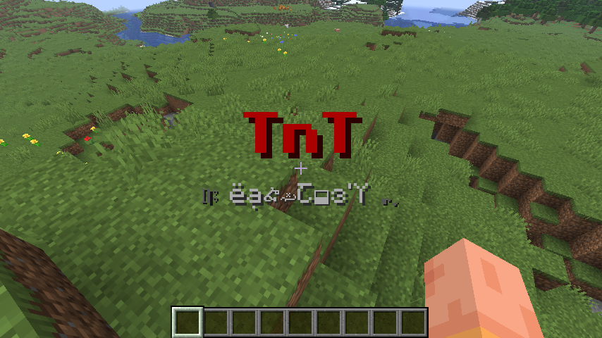
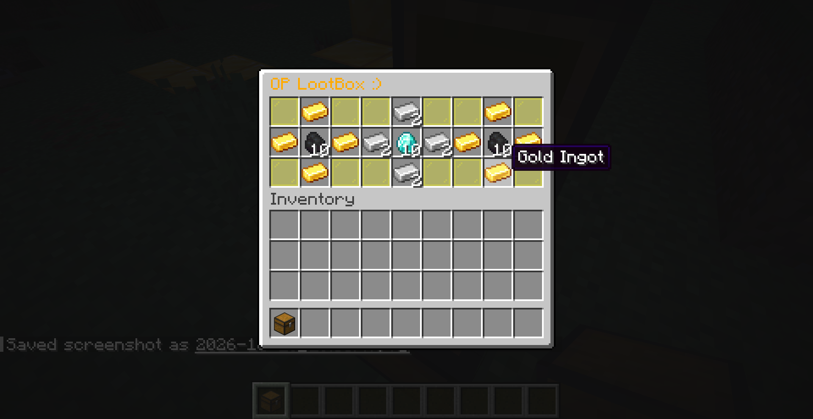
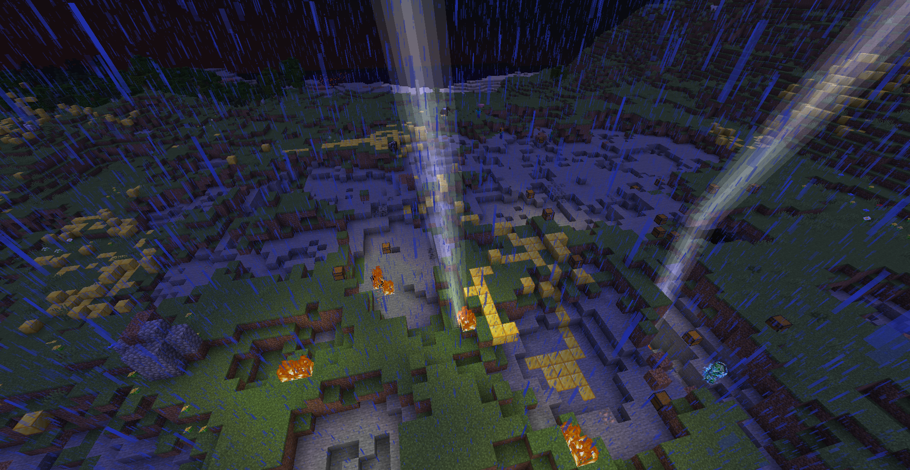

# Event randomizer

Watch your Minecraft world slowly turn into chaos with 11 unique events selected randomly each 5 minutes.Some of them are good and some are bad, you can play solo all with other players. 

# Description

This project is a Minecraft mod for Fabric 26.3. It adds 11 events that are drawn every 5 minutes some of them are bad and some are good. You can find a list of all the events in the spoilers section. Your goal is simply to beat the game but it won't be that easy.

# Setup

You will need:

- Legally obtained copy of Minecraft Java edition

- PC with any operating system

Setup:

- Install fabric loader for version 26.3 throught your custom launcher or if your using official mojang launcher use the [official fabric installer](https://fabricmc.net/use/installer/)

- Put the mod from the [release page](https://github.com/enderx20/Event-randomizer/releases/tag/1.0) in your mods folder (For the official launcher you need to open start menu (windows +r) and type in : %appdata% then go to .Minecraft, mods and put the mod there (If there is no mods folder just create one) )

- Launch your game and enjoy

# Screenshots

# Spoilers

Here is a list of all events:

- Charged creeper

- Midas 

- Fireball rain 

- Loot chest

- Replace your tools to wodden

- Loot box rain

- Water is dangerous

- Replace your tools to diamond

- Water flood

- Insta mining

- Thunderstorm

